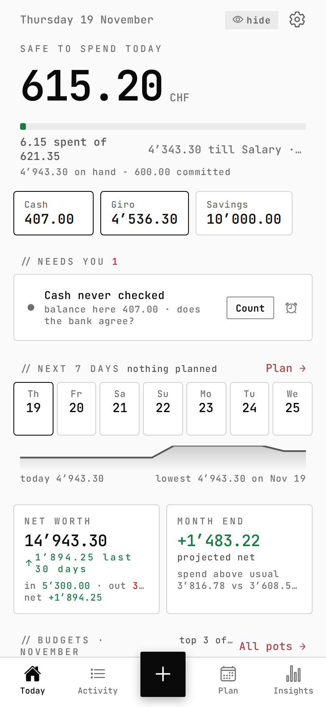
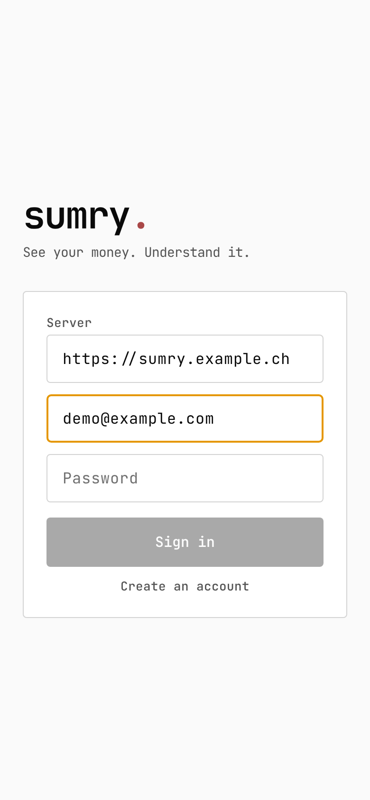
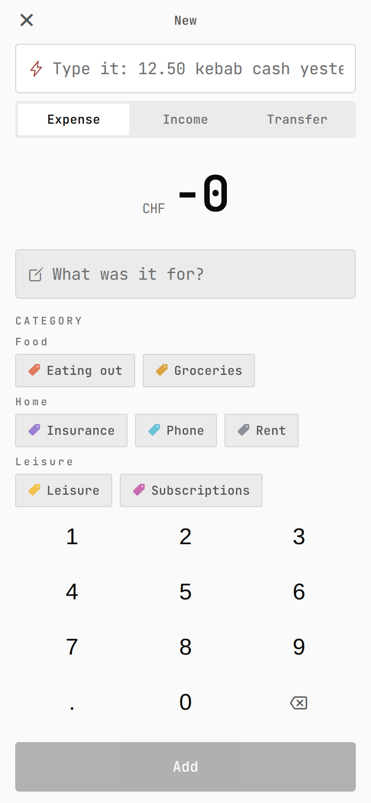
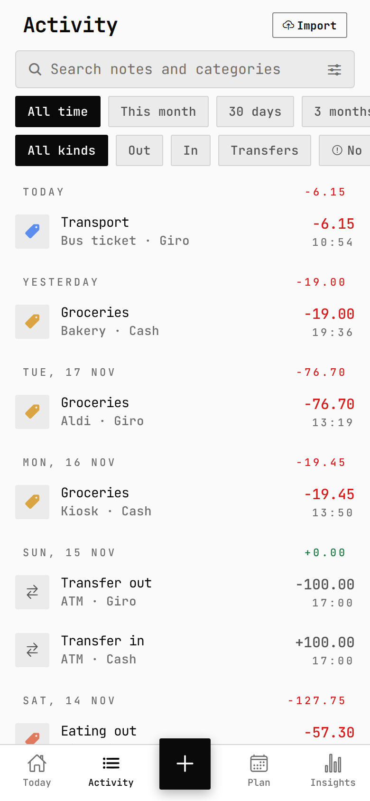
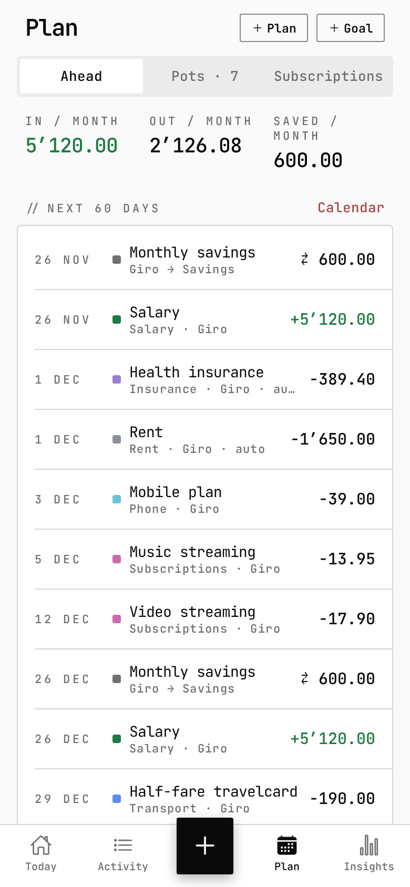
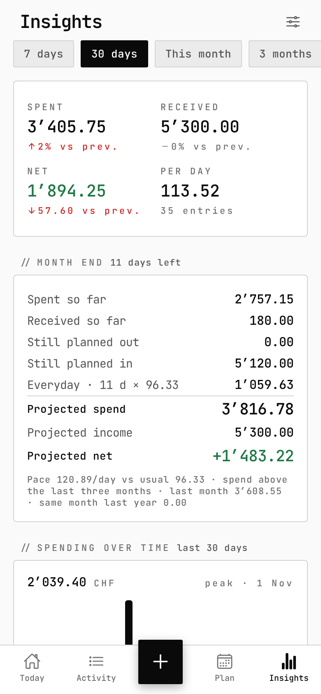

<a id="readme-top"></a>

<div align="center">

<h1>sumry.</h1>

<p><b>A calm personal finance tracker you can host yourself.</b><br>This is the phone app: Expo and React Native, released as an Android APK.<br>It runs on the <a href="https://github.com/elyesghazel/sumry-backend">sumry-backend</a> API; the web app is <a href="https://github.com/elyesghazel/sumry-frontend">sumry-frontend</a>.</p>

<p>
  <a href="https://github.com/elyesghazel/sumry-app/actions/workflows/ci.yml"></a>
  <a href="https://github.com/elyesghazel/sumry-app/releases"></a>
  <a href="LICENSE"></a>
  
  
</p>

<p><a href="#install"><b>Install</b></a> · <a href="#features"><b>Features</b></a> · <a href="#your-own-server"><b>Your own server</b></a> · <a href="#development"><b>Development</b></a> · <a href="#license"><b>License</b></a></p>

</div>

---

<p align="center"></p>

Sumry shows how much you can spend today without touching what is already planned, where
the month is heading and what is due next. The app is built for logging on the go: open it,
type an amount, tap a category, done. Or type the whole line, `12.50 kebab cash yesterday`,
and the form fills itself. It talks only to the Sumry server you sign in to.

## Install

### Android

Download `sumry-<version>.apk` from the [latest release](https://github.com/elyesghazel/sumry-app/releases/latest),
open it on the phone and allow the install when Android asks. There is no Play Store build
yet. Updates are a new APK from the same page, installed over the old one.

The APKs are built by GitHub Actions from the tagged source and signed with the project's
release key. They are arm64 only, which covers phones from the last several years.

### iPhone

There is no App Store build. Use the web app instead: open your Sumry address in Safari,
tap **Share**, then **Add to Home Screen**. It runs full screen like an app. See
[Install on iPhone](https://github.com/elyesghazel/sumry-frontend#install-on-iphone-pwa)
in the frontend README.

Testers can run this app in [Expo Go](https://apps.apple.com/app/expo-go/id982107779) from
a development server (see [Development](#development)).

### Signing in

The sign-in screen has a **Server** field. It defaults to the hosted instance; enter your
own address (`sumry.example.ch` is enough, `https://` is added) to use a self-hosted one.
The app checks that a Sumry server answers there before it sends your credentials.
Switching to another server signs you out of the old one and drops its cached data.

<p align="center"></p>

## Features

- **Today.** Safe to spend until the next planned income, account balances, a "needs you"
  list (accounts to check against the bank, plans to book), the next 7 days, net worth, the
  month-end forecast and budgets.
- **Entry.** A keypad with categories grouped by type, presented from the middle of the tab
  bar. The quick line above it takes `12.50 kebab cash yesterday`, `got 300 salary` or
  `500 from giro to savings`; the server parses it, so phone and web agree. Long-press the
  button for a transfer.
- **Activity.** Every entry grouped by day, searched and filtered by period, kind and
  category. Each row opens the editor.
- **Plan.** Planned income, bills and savings transfers for the next 60 days with what comes
  in and goes out per month, pots and goals, and subscriptions detected from history.
- **Insights.** Spent and received against the previous period, the month-end forecast and
  spending over time.
- **Budgets** with a period, a start day and rollover, and pace against elapsed time.
- **Import** a bank statement (PDF, camt.053 XML, CSV) from the phone, check every row,
  then book.
- **Settings.** Theme, hidden amounts, app lock with Face ID or fingerprint, haptics,
  currency, accounts and reconciling, categories and rules, CSV and JSON export, the monthly
  statement, and a token for an Apple Pay shortcut that logs card payments.

| Entry | Activity |
| --- | --- |
|  |  |
| **Plan** | **Insights** |
|  |  |

The screenshots show invented demo data from
[`deploy/demo-seed.sh`](https://github.com/elyesghazel/sumry-backend/blob/main/deploy/demo-seed.sh)
in the backend repo, rendered from the web build of this app.

## Your own server

The [sumry-backend self-host guide](https://github.com/elyesghazel/sumry-backend/tree/main/deploy)
runs the whole stack in one compose file: Postgres, Redis, the API, the web app and Caddy
with automatic HTTPS. Once it is up, enter its address in the **Server** field on the
sign-in screen. The app needs nothing else from your side; registration, plan limits and
the other server options are set on the backend
([configuration](https://github.com/elyesghazel/sumry-backend#configuration)).

The release APK only accepts `https` servers. Plain `http` works in development builds, for
a backend on your LAN.

## Development

Needs Node 22 and a backend (in sumry-backend: `docker compose up -d --build`, API on
`:48090`).

```bash
npm install
cp .env.example .env    # EXPO_PUBLIC_API_URL sets the default server
npx expo start          # scan the QR code with Expo Go, or press w for the web build
npm run typecheck
npm run check-core      # src/core must match sumry-frontend core/
```

A phone cannot reach `localhost` on your machine. Point `EXPO_PUBLIC_API_URL` at your
machine's LAN address instead, e.g. `http://192.168.1.20:48090`, or type it into the server
field.

```
app/                 expo-router routes
  _layout.tsx        providers and the session gate
  sign-in.tsx        server field, sign in and sign up
  (tabs)/            Today, Activity, Plan, Insights and the entry button
  entry.tsx          the keypad, presented as a modal
  budgets.tsx, import.tsx, safe.tsx, statement.tsx, settings/, account/, category/, planned/, pot/
src/
  core/              shared with the web app, generated by sumry-frontend scripts/sync-core.sh
  api.ts             backend client on top of core
  store.tsx          session and data in one context
  lib/server.ts      server choice and validation
  theme.ts           palette, spacing, type scale
  components/
```

State is a single context rather than a data-fetching library: the whole dataset is a few
hundred rows, so every mutation re-reads it.

### Releases

Pushing a `v*` tag runs [`.github/workflows/release.yml`](.github/workflows/release.yml):
`expo prebuild`, `gradlew assembleRelease`, signing with the keystore from the repository
secrets (`ANDROID_KEYSTORE_BASE64`, `ANDROID_KEYSTORE_PASSWORD`, `ANDROID_KEY_ALIAS`,
`ANDROID_KEY_PASSWORD`), and `sumry-<version>.apk` attached to the GitHub Release. The
version name comes from the tag, the version code is
`major * 1000000 + minor * 1000 + patch`. Over-the-air updates are off in these builds, so
an APK only ever runs the code it was built from.

A fork that wants its own builds needs its own keystore in those secrets, and its own name
and icon (see [TRADEMARK.md](TRADEMARK.md)). An iOS build needs an
[Apple Developer Program](https://developer.apple.com/programs/) membership and your own
Expo project (`eas build --platform ios`).

See [CONTRIBUTING.md](CONTRIBUTING.md) for checks, commits and the CLA. Security reports go
through the backend's [SECURITY.md](https://github.com/elyesghazel/sumry-backend/blob/main/SECURITY.md).

## License

[AGPL-3.0](LICENSE). You may self-host Sumry, change it and use it commercially. If you
modify it and offer it to others as a service over a network, you have to publish the source
of your modified version under the same license.

The name "Sumry" and the logo are not part of the license: forks and public hosts use their
own name. See [TRADEMARK.md](TRADEMARK.md). Contributions are accepted under the
[CLA in CONTRIBUTING.md](CONTRIBUTING.md#contributor-license-agreement).

<div align="right"><a href="#readme-top">back to top ↑</a></div>
